# Ebtesamty — Data Model & State Transitions Specification

## 1. Entity-Relationship Overview

The Ebtesamty database is powered by **PostgreSQL** and managed through version-controlled **Prisma ORM** migrations (`prisma/schema.prisma`). It strictly separates organizational entities, patient identity, clinical intake, scheduling, clinical encounters, billing, inventory, and audit logs.

```mermaid
erDiagram
    Branch ||--o{ Room : has
    Branch ||--o{ RoleGrant : scopes
    Branch ||--o{ DoctorDuty : schedules
    Branch ||--o{ Appointment : hosts
    Branch ||--o{ Encounter : records
    Branch ||--o{ Invoice : issues
    Branch ||--o{ StockLot : stocks
    User ||--o{ RoleGrant : holds
    User ||--o| StaffProfile : has
    User ||--o{ PortalPatientLink : links
    Patient ||--o{ PortalPatientLink : authorizes
    Patient ||--o{ MedicalHistorySubmission : submits
    Patient ||--o{ AppointmentRequest : requests
    Patient ||--o{ Appointment : attends
    Patient ||--o{ Encounter : undergoes
    Patient ||--o{ ToothFinding : charts
    Patient ||--o{ TreatmentPlan : receives
    Patient ||--o{ Invoice : owes
    Patient ||--o{ Payment : pays
    Encounter ||--o{ ClinicalNoteAddendum : amends
    TreatmentPlan ||--o{ TreatmentPlanItem : contains
    Invoice ||--o{ InvoiceLine : itemizes
    Invoice ||--o{ PaymentAllocation : settles
    Payment ||--o{ PaymentAllocation : allocates
    Material ||--o{ StockLot : batches
    Material ||--o{ StockMovement : logs
    Material ||--o{ StockTransfer : transfers
```

---

## 2. Four Independent Lifecycle State Machines

Ebtesamty enforces strict separation between **Booking**, **Visit**, **Payment**, and **Treatment Plan** states:

### 2.1 Booking Lifecycle (`AppointmentRequestStatus` & `AppointmentStatus`)
- **Request States**: `REQUESTED` → `IN_REVIEW` → `CONFIRMED` | `ALTERNATIVE_PROPOSED` | `DECLINED` | `CANCELLED`
- **Confirmed Appointment States**: `CONFIRMED` → `CHECKED_IN` → `IN_CONSULTATION` → `COMPLETED` | `CANCELLED` | `NO_SHOW`
- **Invariants**:
  - Submitting a request (`REQUESTED`) never claims a slot is confirmed until validated against `DoctorDuty` and overlapping `Appointment` records inside a database transaction.
  - Cancelling an appointment requires a `cancellationReason` and preserves the historical record.

### 2.2 Visit & Clinical Queue Lifecycle (`QueueStatus` & `EncounterStatus`)
- **Arrival Verification**: `ArrivalEvent` (`isVerified: false` → `true` upon receptionist physical ID check).
- **Queue States**: `WAITING` → `CALLED` → `IN_CONSULTATION` → `COMPLETED` | `DEPARTED_UNSEEN`.
- **Clinical Encounter States**: `DRAFT` → `FINALIZED`.
- **Invariants**:
  - Once `Encounter.status === 'FINALIZED'`, `chiefComplaint`, `examinationFindings`, `finalizedDiagnosis`, and `clinicalNotes` are immutable. Any subsequent clinical amendment must be appended as an attributed `ClinicalNoteAddendum`.

### 2.3 Financial & Payment Lifecycle (`InvoiceStatus` & `PaymentStatus`)
- **Invoice States**: `DRAFT` → `ISSUED` → `PARTIALLY_PAID` → `PAID` | `VOIDED`.
- **Payment States**: `POSTED` | `REFUNDED` (with `idempotencyKey` uniqueness constraint).
- **Installment States**: `InstallmentPlanStatus` (`ACTIVE`, `SATISFIED`, `DEFAULTED`) and `InstallmentStatus` (`PENDING`, `PAID`, `OVERDUE`).
- **Invariants**:
  - Completing a clinical visit does not automatically mark an invoice `PAID`.
  - Every payment requires a unique `idempotencyKey` so network retries or browser refreshes never double-count collections.
  - All monetary values are stored in integer **Piasters** (`1 EGP = 100 Piasters`).

### 2.4 Treatment Plan Lifecycle (`TreatmentPlanStatus` & `TreatmentItemStatus`)
- **Plan States**: `DRAFT` → `PROPOSED` → `ACCEPTED` → `COMPLETED` | `CANCELLED`.
- **Procedure Item States**: `PLANNED` → `IN_PROGRESS` → `PERFORMED` | `DECLINED` | `DEFERRED`.
- **Invariants**:
  - Proposed or planned treatment items (`PLANNED`) are never mixed with performed billable procedures (`PERFORMED` linked to `performedEncounterId`).

---

## 3. Multi-Branch & Identity Rules
1. **Non-Unique Household Phones**: `Patient.primaryPhone` is indexed but intentionally non-unique so family members in Egypt can share a mobile number without overwriting each other's records.
2. **Duplicate Detection Without Auto-Merge**: When a new patient or online booking matches an existing phone, name, or National ID, a `PotentialDuplicateReview` (`PENDING`) is created for receptionist verification (`REVIEWED_DISTINCT` or `RESOLVED_MERGED`).
3. **Traceable Stock Transfers**: `StockTransfer` records move through `REQUESTED` → `SHIPPED` (deducting source `StockLot` with `TRANSFER_OUT` movement) → `RECEIVED` (incrementing destination `StockLot` with `TRANSFER_IN` movement).
