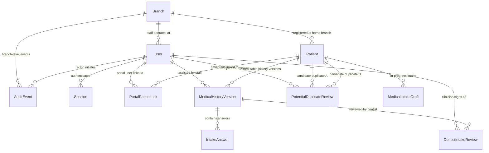

# Ebtesamty Relational Data Model (PostgreSQL)

**Schema Engine:** PostgreSQL 15+ (Validated on PostgreSQL 18.x)  
**ORM / Migration Tool:** Prisma ORM with version-controlled SQL migrations  
**Target File:** `prisma/schema.prisma` -> `prisma/migrations/20261016232217_init_phase01_foundation/migration.sql`

---

## 1. Entity Relationship Diagram (Mermaid)

---

## 2. Table Specifications & Invariants

### 2.1 Branch (`branches`)
Represents the three physical operating branches of Ebtesamty Clinics in Egypt.
- `id` (VARCHAR/UUID, PK): Unique branch identifier.
- `nameEn` / `nameAr` (VARCHAR): Bilingual branch name (e.g. "Branch A - Heliopolis", "فرع أ - مصر الجديدة").
- `code` (VARCHAR, UNIQUE): Unique branch code (`BRANCH_A`, `BRANCH_B`, `BRANCH_C`).
- `addressEn` / `addressAr` (VARCHAR): Physical address.
- `phone` (VARCHAR): Branch landline/hotline.
- `isActive` (BOOLEAN): Soft-disable branch operations if required.

### 2.2 User (`users`)
Unified identity table for staff members and portal patients.
- `id` (UUID, PK): Unique user identifier.
- `email` (VARCHAR, UNIQUE): Login credential (case-insensitive indexed).
- `passwordHash` (VARCHAR): Salted bcrypt hash.
- `fullName` (VARCHAR): User display name.
- `role` (ENUM: `PATIENT`, `RECEPTIONIST`, `DENTIST`, `BRANCH_MANAGER`, `SYSTEM_ADMIN`): Strict RBAC role.
- `branchId` (UUID, FK -> Branch, NULLABLE): Mandatory for staff; null for self-registered portal patients.
- `licenseNumber` (VARCHAR, NULLABLE): Egyptian Dental Syndicate registration number for dentists.
- `isActive` (BOOLEAN): Immediate deactivation flag.

### 2.3 Patient (`patients`)
Core electronic clinical patient master index (EMPI).
- `id` (UUID, PK): Internal surrogate key.
- `patientNumber` (VARCHAR, UNIQUE): Public clinical file number (`EBT-PAT-YYYY-XXXX`).
- `fullName` (VARCHAR): Patient legal name.
- `dateOfBirth` (DATE): Required for age-dependent dosage and pediatric dental warnings.
- `gender` (ENUM: `MALE`, `FEMALE`, `OTHER`, `UNDISCLOSED`).
- `primaryPhone` (VARCHAR, INDEXED): Contact telephone number. **NOT UNIQUE** (enables family household sharing without record hijacking).
- `secondaryPhone` (VARCHAR, NULLABLE).
- `email` (VARCHAR, NULLABLE): Optional; walk-in patients do not require an email address.
- `nationalId` (VARCHAR, NULLABLE, INDEXED): Egyptian National ID number.
- `homeBranchId` (UUID, FK -> Branch): Primary registered clinic branch.
- `assignedDentistId` (UUID, FK -> User, NULLABLE): Assigned primary clinician.
- `source` (ENUM: `WALK_IN`, `PHONE_INQUIRY`, `ONLINE_SELF_REG`, `LEGACY_MIGRATION`).
- `legacySystemId` (VARCHAR, NULLABLE): Cross-reference identifier for migrated legacy records.
- `legacyNotes` (TEXT, NULLABLE): Preserved historical migration notes.
- `intakeStatus` (ENUM: `NOT_STARTED`, `IN_PROGRESS`, `PENDING_REVIEW`, `REVIEWED`, `UPDATE_REQUIRED`).

### 2.4 PortalPatientLink (`portal_patient_links`)
Manages the zero-trust link between an online portal user account (`User`) and a clinical patient record (`Patient`).
- `id` (UUID, PK).
- `userId` (UUID, FK -> User): Portal user.
- `patientId` (UUID, FK -> Patient): Clinical patient file.
- `status` (ENUM: `PENDING`, `APPROVED`, `REJECTED`, `REVOKED`).
- `verificationMethod` (ENUM: `NATIONAL_ID_IN_CLINIC`, `PHONE_OTP`, `STAFF_MANUAL_REVIEW`).
- `verifiedByUserId` (UUID, FK -> User, NULLABLE): Receptionist who inspected physical documents.
- `verifiedAt` (TIMESTAMP, NULLABLE).
- `rejectionReason` (TEXT, NULLABLE).
- **Invariant:** `UNIQUE(userId, patientId)`.

### 2.5 MedicalIntakeDraft (`medical_intake_drafts`)
Temporary working draft for multi-step intake completion.
- `id` (UUID, PK).
- `patientId` (UUID, FK -> Patient, UNIQUE).
- `lastStep` (INT): Active step (1: Systemic, 2: Allergies/Bleeding, 3: Meds, 4: Dental, 5: Review).
- `formData` (JSONB): Form payload in progress.
- `savedByUserId` (UUID, FK -> User): Indicates whether the patient or a receptionist assisted in saving the draft.
- `updatedAt` (TIMESTAMP).

### 2.6 MedicalHistoryVersion (`medical_history_versions`)
Immutable snapshot of patient medical disclosures at submission time.
- `id` (UUID, PK).
- `patientId` (UUID, FK -> Patient).
- `versionNumber` (INT): Monotonically incrementing version (1, 2, 3...).
- `isCurrentVersion` (BOOLEAN): Flags active clinical disclosures. Set to `false` when a newer version is submitted.
- `submittedByUserId` (UUID, FK -> User): User who submitted the intake.
- `submissionChannel` (ENUM: `PATIENT_PORTAL_SELF`, `RECEPTION_ASSISTED_KIOSK`, `CHAIRSIDE_ASSISTED`).
- `assistedStaffId` (UUID, FK -> User, NULLABLE): Receptionist ID if assisted at desk.
- `chiefComplaint` (TEXT): Free-text patient description of dental concern.
- `consentAgreed` (BOOLEAN): Mandatory legal affirmation.
- `consentTimestamp` (TIMESTAMP).
- **Invariant:** `UNIQUE(patientId, versionNumber)`.

### 2.7 IntakeAnswer (`intake_answers`)
Granular questions and responses associated with a `MedicalHistoryVersion`.
- `id` (UUID, PK).
- `historyVersionId` (UUID, FK -> MedicalHistoryVersion).
- `category` (ENUM: `SYSTEMIC_DISEASE`, `BLEEDING_AND_ALLERGIES`, `CURRENT_MEDICATIONS`, `DENTAL_SYMPTOMS`, `LIFESTYLE_HABITS`).
- `questionKey` (VARCHAR): Standard question code (e.g., `HYPERTENSION`, `DIABETES`, `PENICILLIN_ALLERGY`, `BLOOD_THINNERS`).
- `questionTextEn` / `questionTextAr` (VARCHAR): Bilingual question text rendered to patient.
- `answer` (ENUM: `YES`, `NO`, `UNKNOWN`).
- `notes` (TEXT, NULLABLE): Specific details (e.g., "Takes Metformin 500mg BID").

### 2.8 DentistIntakeReview (`dentist_intake_reviews`)
Clinical review and sign-off by an authorized dentist.
- `id` (UUID, PK).
- `historyVersionId` (UUID, FK -> MedicalHistoryVersion).
- `reviewerDentistId` (UUID, FK -> User).
- `reviewedAt` (TIMESTAMP).
- `status` (ENUM: `CLEARED_FOR_TREATMENT`, `MEDICAL_CONSULTATION_REQUIRED`, `CONTRAINDICATION_FLAGGED`, `SPECIAL_PRECAUTIONS_NOTED`).
- `clinicalNotes` (TEXT, NULLABLE): Specific dentist observations (e.g., "Premedicate with Amoxicillin 2g 1hr prior to invasive procedure").
- `actionFlags` (JSONB, NULLABLE): Keyed flags (e.g. `{"requiresProphylacticAntibiotic": true}`).

### 2.9 PotentialDuplicateReview (`potential_duplicate_reviews`)
Staff queue for suspected duplicate patient files (prevents automatic data destruction).
- `id` (UUID, PK).
- `primaryPatientId` (UUID, FK -> Patient).
- `candidatePatientId` (UUID, FK -> Patient).
- `matchScore` (FLOAT): Confidence score (0.0 - 1.0).
- `matchType` (ENUM: `EXACT_NATIONAL_ID`, `SAME_PHONE`, `SIMILAR_NAME_AND_DOB`).
- `status` (ENUM: `PENDING`, `REVIEWED_DISTINCT`, `MERGED_PENDING_PHASE02`, `DISMISSED`).
- `reviewedByUserId` (UUID, FK -> User, NULLABLE).
- `resolutionNotes` (TEXT, NULLABLE).

### 2.10 AuditEvent (`audit_events`)
Tamper-resistant audit log capturing critical security and administrative actions.
- `id` (UUID, PK).
- `timestamp` (TIMESTAMP WITH TIME ZONE, DEFAULT NOW()).
- `actorUserId` (UUID, FK -> User, NULLABLE).
- `actorRole` (VARCHAR).
- `branchId` (UUID, FK -> Branch, NULLABLE).
- `action` (VARCHAR): E.g., `PATIENT_CREATED`, `INTAKE_SUBMITTED`, `INTAKE_REVIEWED`, `PORTAL_LINK_APPROVED`.
- `entityType` (VARCHAR): E.g., `Patient`, `MedicalHistoryVersion`, `PortalPatientLink`.
- `entityId` (VARCHAR).
- `ipAddress` (VARCHAR, NULLABLE).
- `userAgent` (VARCHAR, NULLABLE).
- `metadata` (JSONB): Operational details **strictly sanitized of raw PHI**.
